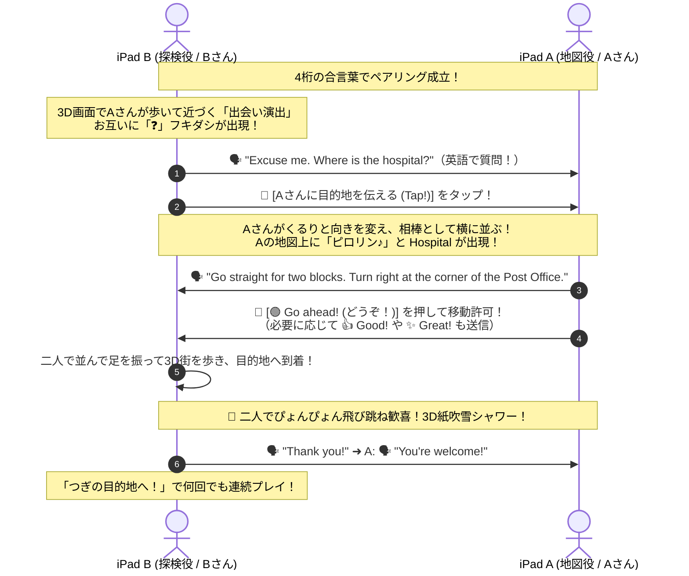

# 【説明資料・指導案】英語道案内アクティビティ「Where is OO?」

> 本ドキュメントは、校内研修、指導案作成、および教育委員会・職員会議等でのプレゼンテーション（PowerPoint / Word）にそのまま転記・活用できるよう構成されています。

---

## 1. 教材基本情報

| 項目 | 内容 |
| :--- | :--- |
| **教材名** | Where is OO?（ウェア・イズ・オーオー？） |
| **対象学年** | 小学校高学年（外国語活動・外国語科）、中学校第1学年〜第2学年 |
| **教科・領域** | 外国語（英語） / 総合的な学習の時間（情報活用能力育成） |
| **形態** | 2人1組（ペアワーク） |
| **必要機材** | 児童生徒用 iPad（2人に2台＝1人1台環境） |
| **動作環境** | iPad Safariブラウザ（Apache Webサーバー経由、完全オフライン動作対応） |
| **単元名（例）** | 「道案内をしよう (Directions)」「Welcome to Our Town」 |

---

## 2. 開発背景と教育的ねらい（本物の双方向対話の成立）

従来の紙のワークシートを用いたペアワーク道案内では、**「お互いの手元が見えてしまい、日本語で指を差して教えてしまう」「一方的に指示役が話して探索役が受け身になる」** という課題が頻発していました。

本教材は、この課題を解決するために **「双方向のインフォメーション・ギャップ（情報の非対称性）」** をWebテクノロジーで設計しています。

* **iPad B（探索役 / 旅行者）:** ペアリングすると、行きたい目的地（ミッション）がランダムで決定。相手に英語で **"Excuse me. Where is the [建物名]?"** と尋ねる必然性が生まれます。
* **iPad A（指示役 / 街の案内人）:** 2Dの街の全体地図を見ながら、尋ねられた建物の位置を瞬時に確認し、道順を英語で案内します。

**「質問する ➜ 案内する ➜ お礼を言う」という、教科書のモデル対話がそのまま教室内で自然に発生します。**

---

## 3. 単元指導計画案（1コマ 45分授業）

### 本時の目標
* 街の中の施設を表す語句（*hospital, library, convenience store* など）に親しむ。
* 相手に道を尋ねる表現（*Excuse me. Where is the ~?*）と、道順を教える表現（*Go straight, Turn right/left, It's on your right/left*）を用いて、ペアで協力して目的地に到達できる。
* 相手の目線や方角に配慮しながら粘り強くコミュニケーションをとる態度を養う。

### 指導プロセス

| 時間 | 学習活動 | 指導上の留意点・支援 |
| :--- | :--- | :--- |
| **導入 (5分)** | ・挨拶、チャンツによる施設名・方向の復習。 ・本時のめあてを確認。 | 「道に迷ったとき、何て声をかける？」を想起させ、*Excuse me. Where is the ~?* を全体確認。 |
| **展開① (10分)** | ・教師と代表生徒（またはALT）でiPadを用いたデモを実施。 ・iPad Bが尋ね、iPad Aが答える流れを実演。 | 「画面を絶対に見せないこと」を楽しく徹底する。 |
| **展開② (20分)** | ・ペアで接続しアクティビティ開始。 ・第1ミッション、第2ミッションとテンポよく挑戦。 ・途中で役割（iPad AとB）を交代。 | 巡視し、探索役が質問する声、案内役が「何ブロック」と具体的に指示する工夫を賞賛する。 |
| **まとめ (10分)** | ・何箇所回れたかをペアで確認。 ・上手くいった指示の仕方を共有。 ・振り返りカードに記入。 | 「相手の向いている方角を考える大切さ」に気づいた生徒の発言を取り上げ、空間認識と言葉の結びつきを深める。 |

---

## 4. PowerPointプレゼンテーション用 スライド構成案（10枚）

### [Slide 1] 表紙
* **タイトル:** 英語道案内ペアワークアクティビティ「Where is OO?」
* **サブタイトル:** 双方向のインフォメーション・ギャップで創る「本物の英語対話」
* **発表者:** [学校名・学年・氏名]

### [Slide 2] 英語授業における課題意識
* **従来の課題:**
  * 教科書の道案内ワークは、プリントの答えを日本語で指差して終わりになりがち。
  * 指示役だけが話して、もう1人はただ聞くだけ（受動的）になりやすい。
* **本教材の解決策:**
  * **「探索役から質問が始まる」対話設計！**

### [Slide 3] 役割と会話の黄金サイクル
* **Step 1 [iPad B]:** ランダムなミッション出現 ➜ *"Excuse me. Where is the hospital?"*
* **Step 2 [iPad A]:** 地図を見てルート指示 ➜ *"Go straight for 2 blocks. Turn right."*
* **Step 3 [iPad B]:** 3D街を歩いて到着 ➜ *"Thank you!"* ➜ *"You're welcome!"*
* 教科書の定型対話がそのまま教室で実現！

### [Slide 4] 児童生徒を引き込む3つの仕掛け
1. **親しみやすい3Dボクセル空間のビジュアル**
2. **直感的なオンスクリーンコントローラー（▲前進、◀90度旋回、90度旋回▶）**
3. **達成感あふれる紙吹雪とゴール演出 ＋ 「つぎの目的地へ」連続プレイ**

### [Slide 5] リアルタイム連携 vs 完全オフライン対応
* **ハイブリッド同期システムを搭載**
  * **WebRTCモード:** 4桁合言葉で自動接続。相手の歩く姿が地図上で動く！
  * **シード共有モード:** 通信遮断環境でも机番号（01, 02）を入れるだけで完全動作！

### [Slide 6] 英語が苦手な子も安心の「音声サポート」
* iPad Bの画面に「🔊 きく」ボタンを配置。
* ネイティブ発音を聴いてから自信を持って相手に質問できるユニバーサルデザイン設計。

### [Slide 7] 英語力だけでなく「思考力・相手意識」を育む
* 「自分から見て右」ではなく「相手が向いている方向から見て右」を伝える必要がある。
* ランドマークを目印にする論理的伝達力の育成。

### [Slide 8] 現場の先生に優しい設計
* **インストール不要:** Safariで開くだけ。
* **サーバー維持費0円・バックエンド不要:** Apacheの静的配信のみで完結。

### [Slide 9] 児童生徒・教員の実践の声
* 「自分から英語で質問できたのが嬉しかった！」
* 「次々に新しい目的地が出るから、飽きずに何回も話せた」
* 「ペアで役割を交代して何周も楽しめた」

### [Slide 10] まとめ
* テクノロジーを「必然性のあるコミュニケーションの道具」へ。
* ご清聴ありがとうございました。
